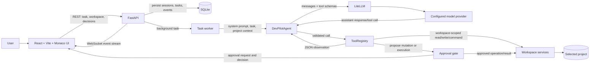

# DevPilot technical report draft

## Abstract

DevPilot is a local AI coding workspace developed alongside the mini-SWE-agent project. It combines a React/Vite/Monaco interface with a FastAPI backend, SQLite session and event history, LiteLLM provider access, and a custom DevPilot agent loop. The loop exposes nine structured workspace tools through a Pydantic-validated registry and returns tool results to the model as observations. File mutations and command/test execution require user approval.

The submitted implementation has been verified with deterministic mocked model responses and a temporary local OpenAI-compatible mock provider. In the browser demonstration, the agent created a calculator and its tests, obtained approvals, ran pytest, and displayed 10 passing tests. A cancellation demonstration also ended with a cancelled task and no write. These results validate the app/tool/approval path, **not live LLM connectivity**. No provider model or credentials are configured in the inspected environment, and no real provider request has been made.

## 1. Problem statement

Coding-assistant demonstrations need more than a chat panel: they need an execution loop that can inspect a project, choose bounded actions, apply changes only under understandable controls, run tests, and report actual results. An unrestricted shell-only interface makes tool behavior and approval boundaries harder to demonstrate. DevPilot addresses this by separating the model-facing loop, structured tool registry, workspace services, approval workflow, persistence, and UI.

The scope is a single-user, local MVP. It is not a hosted service, an OS-level sandbox, or a claim that a particular commercial model has been validated.

## 2. Objectives and requirements

The implementation targets these observable requirements:

1. Accept a natural-language task in the browser and associate it with a selected local workspace/session.
2. Provide bounded project context and individually callable file, search, command, test, and Git capabilities.
3. Validate model tool names/arguments, execute an accepted operation, and feed the actual result to the next model request.
4. Require explicit user approval before file changes, commands, and tests; report denials/failures rather than claiming success.
5. Persist session/task/event history and stream execution activity to the UI.
6. Bound iteration, runtime, model-request and command duration, workspace reads, and outputs.
7. Preserve the upstream mini-SWE-agent CLI, source, license, and attribution while making DevPilot's own task loop clear.

The implementation meets these MVP goals subject to the limitations in Section 10. It does not currently meet live-provider validation or OS-isolated execution as a submission claim.

## 3. System architecture

The frontend provides workspace selection, explorer/editor, task entry, approval controls, activity/test/terminal views, and Git status/diff. REST handles sessions, tasks, files, and approvals. A WebSocket streams persisted events. FastAPI's task worker constructs the workspace callbacks and runs `DevPilotAgent`; `EventStore` writes sessions, tasks, and events to SQLite.



DevPilot and its upstream project boundary is described in [ARCHITECTURE.md](./ARCHITECTURE.md). DevPilot is not implemented through mini-SWE-agent's upstream `DefaultAgent`. The original `mini` CLI and its upstream execution components remain available and attributed. LiteLLM is reused as the provider client; the DevPilot loop, registry, API integration, approval wiring, UI, and their tests are DevPilot application code.

### Persistence and lifecycle

`EventStore` stores session, task, and event records in SQLite. The default database is `%USERPROFILE%\.devpilot\sessions.sqlite3`, configurable with `DEVPILOT_DB_PATH`. Task workers, cancellation events, and pending approvals are process-local. A restart preserves stored history but does not resume a task or pending approval.

## 4. Custom agent loop: Think → Act → Observe

`DevPilotAgent` in `src/devpilot/agent.py` performs the following cycle. “Think” here means the model request and returned choice; the implementation does not expose or log private chain-of-thought.

1. **Think — construct and request.** The task worker resolves the task-specific model or `DEVPILOT_MODEL_NAME` (with `MSWEA_MODEL_NAME` as a fallback), calls `inspect_project`, and provides a system prompt, the user task, and serialized project context. Each iteration calls `litellm.completion` with the conversation, `ToolRegistry` function schemas, `tool_choice="auto"`, and a configured timeout. The API loads local `.env` values into the backend process; credentials are not sent to the browser.
2. **Think — interpret the response.** The agent normalizes the assistant message, emits its visible content, and inspects its tool calls. A non-empty response with no tool call completes the task unless the finish reason indicates truncation, in which case the task stops. An empty response without a tool call fails. DevPilot does not use mini-SWE-agent's completion sentinel.
3. **Act — validate and dispatch.** The model-selected tool name and JSON arguments are passed to `ToolRegistry`. The registry rejects unknown names, malformed/non-object JSON, extra fields, and schema violations. The loop executes no more than one tool per assistant response: 2–4 requested calls each receive rejection observations and none execute; more than four makes the turn fail.
4. **Observe — return actual output.** A valid single call is executed by its registered handler. The assistant tool-call message and a corresponding `role="tool"` message containing the real result are appended to the conversation and emitted as activity events. The next model request sees that observation and may choose a new action. Expected validation, workspace, command-policy, and OS errors become failure observations. Provider or unexpected worker exceptions fail the task rather than produce a success-shaped response.
5. **Finish or stop.** A final non-empty assistant response completes the task. The result also records status, iteration/model/tool counts, optional provider-reported cost, and an error/stop reason. Cancellation, iteration/runtime limits, truncation, or failures stop the loop.

Defaults include 30 iterations, a 30-minute total runtime, a 120-second per-request timeout (configurable from 1 to 120 seconds), and bounded conversation history. The iteration limit is configurable from 1 to 200. Tool observations are bounded to 64,000 bytes. LiteLLM may report cost, but DevPilot does not enforce a cost ceiling.

## 5. Tool registry and project interaction

`ToolRegistry` creates OpenAI-style function schemas from Pydantic argument models and dispatches validated input to registered callbacks. The current tool set is:

| Tool | Project operation | Access/control |
|---|---|---|
| `list_files` | List workspace-relative files, optionally filter by a relative path prefix | Read-only |
| `read_file` | Read a UTF-8 text file | Workspace-scoped; 1,000,000-byte file limit |
| `search_files` | Search literal text and return bounded path/line/snippet matches | Workspace-scoped; bounded files, bytes, and results |
| `write_file` | Create or replace a file | Proposal; explicit user approval before write |
| `edit_file` | Replace one exact occurrence of text | Proposal; exact-one-match requirement and concurrency hash |
| `run_command` | Run a command allowed by the command policy | Validated argv; explicit approval; no shell |
| `run_tests` | Run `python -m pytest` in the workspace | Explicit approval |
| `get_git_status` | Inspect selected workspace Git status | Read-only |
| `get_git_diff` | Inspect bounded Git diff | Read-only |

These are separate capabilities; Bash is not the sole project interface. The approved command tool remains available for supported commands. Git tools are read-only.

Before the first model call, `inspect_project` builds bounded metadata from the file list and selected manifests: detected language counts, some framework/dependency names, manifest names, and a capped file list. It does not inject every source file into the prompt. The model can ask for more through `read_file` and `search_files`. File listing skips symlinks and common generated/dependency directories; reads/writes are path-checked beneath the selected workspace.

## 6. Approval and cancellation workflow

For `write_file` and `edit_file`, the API creates a pending proposal and emits approval events. The frontend displays the proposed path/action. A write occurs only after approval; hash checks prevent overwriting a file that changed after the proposal. Edit requests must identify one exact occurrence. Denial or expiration returns a failure observation.

`run_command` is validated before an approval request is shown. The user sees the command and explanation before execution. `run_tests` uses the fixed `python -m pytest` command and a separate approval. Results and test output are recorded and returned to the model as observations. Read-only inspection and Git-status/diff operations do not require approval.

The Stop action sets a task cancellation event. The agent checks it between model/tool steps, and the approval wait checks it periodically; cancellation while a write is pending resolves the proposal without writing. Cancellation is cooperative: a synchronous provider request or running subprocess may continue until its configured timeout. The verified UI cancellation run demonstrated the pending-write case, not interruption of an in-flight provider call.

## 7. Security, privacy, and limitations

- **Workspace boundary:** Helpers reject absolute paths, parent traversal, escaping symlinks, non-text reads, and oversized file operations. Enumeration and search are bounded.
- **Command boundary:** Commands are checked against a supported executable/argument policy, parsed to argv, and run with `shell=False`, a filtered child environment, a timeout, and capped output. Git mutation commands are not supported.
- **Approval boundary:** File writes/edits, commands, tests, and requested API deletions require explicit user approval.
- **Credential handling:** Provider credentials are backend-side. Common secret-named environment variables are filtered from child command environments. `.env` is ignored by Git and must never be shown in a recording.
- **Local service boundary:** DevPilot is designed for loopback use and has no multi-user authentication. It must not be exposed as a public service.
- **Residual execution risk:** Approval is not an OS sandbox. Approved Python/Node code, tests, and package hooks run with the current user's permissions and can access resources outside the selected workspace. Use an OS/container sandbox for untrusted projects.
- **Operational limits:** Pending approvals and running workers are process-local; there is no cost ceiling; synchronous calls are not immediately interruptible; no remote deployment hardening is provided.
- **Test-host limitation:** The symlink protection test was skipped because this host does not permit symlink creation.

Further threat model and operational cautions are in [SECURITY.md](./SECURITY.md).

## 8. Implementation choices, challenges, and learnings

### Design decisions

- **Own the control loop:** A small DevPilot module makes request construction, tool selection, observation handling, limits, and completion behavior explicit without replacing mini-SWE-agent's separate CLI.
- **Use structured tools:** Schema-backed tools expose specific workspace operations and make approval boundaries visible. Keeping shell execution as one distinct tool avoids making arbitrary shell the only interface.
- **Reuse workspace/approval services:** Tool callbacks call the existing workspace and approval helpers instead of bypassing path and command policy.
- **Keep persistence lightweight:** SQLite is sufficient for local history. Active workers/approvals remain in memory rather than adding a queue or distributed execution framework to the MVP.
- **Preserve provenance:** The report distinguishes original DevPilot application code from LiteLLM/framework reuse and retained mini-SWE-agent components.

### Challenges addressed

- Maintaining the assistant tool-call and matching tool-observation message shape across sequential requests.
- Ensuring a denied, invalid, or failed action is not reported as successful and that the model can receive a useful failure observation.
- Pausing execution for a human decision without confusing pending approval with completion, and cancelling a task safely while it waits.
- Describing the safety boundary accurately: an allowlist and approval workflow reduce risk but do not isolate executing project code.
- Separating model-behavior evidence from integration evidence: deterministic mocks can verify orchestration, but not provider/model compatibility or quality.

### Learnings

Observable tool results and persisted events make the execution loop easier to demonstrate and test. Explicit schemas and approval callbacks make tool policy easier to explain than a single opaque shell action. A mocked provider is valuable for deterministic, credential-free integration tests, but must be labeled and cannot substitute for a real-provider smoke test. Human approval is useful defense in depth, not a substitute for OS-level isolation.

## 9. Testing methodology and results

The selected automated run exercises DevPilot tests plus the upstream tool-call parser test. DevPilot tests use deterministic `litellm.completion` test doubles; the calculator model chooses its next tool based on actual observations. The tools write files into a temporary workspace, run pytest, and verify the actual output before returning a final response. This does not call an external LLM.

| Validation | Command/evidence | Result |
|---|---|---|
| DevPilot + relevant upstream parser tests | `python -m pytest tests\devpilot tests\models\test_actions_toolcall.py -q -rs` | **46 passed, 1 skipped**; two dependency deprecation warnings. The skip is the symlink test because the host does not permit symlink creation. This is the relevant selected set, not the full upstream suite. |
| Ruff | `python -m ruff check src\devpilot tests\devpilot` | **All checks passed.** |
| Frontend production build | From `frontend`, `npm.cmd run build` | **Passed**, Vite 6.4.6. |
| Mocked calculator agent test | Observation-driven test in `tests/devpilot/test_api.py` | Sequential list/read/write/test actions and model follow-up based on observations; actual pytest output confirmed **10 passed**. No provider credential or external model. |
| Browser UI integration | Temporary local OpenAI-compatible mock endpoint through LiteLLM | Actual UI task submission, streamed events, approvals, file creation and pytest result (**10 passed**) observed. The endpoint was a mock and its temporary runner is not included. |
| Browser UI cancellation | Task cancelled while file approval was pending | `cancelled` state observed; proposed file was absent. |
| Live-provider connectivity | Configuration inspection | `.env` absent; `DEVPILOT_MODEL_NAME`, `MSWEA_MODEL_NAME`, and checked provider credential variables unset; `.env.example` is placeholder-only. **No live provider request was made.** |

The browser demonstration proves the UI/backend/approval path under a local mock. Neither that run nor the automated test establishes real-provider connectivity, model quality, cost, or reliability.

## 10. Future enhancements

1. Configure an authorized provider and document a real, minimal live-provider smoke test with its model identifier and measured outcome.
2. Add a reusable local mock provider runner if credential-free browser demonstrations must be reproducible; keep its deterministic/mock status explicit.
3. Execute untrusted projects in an OS-level container or VM with resource and network limits.
4. Make worker state, cancellation, and pending approvals restart-safe if longer sessions require it.
5. Add configurable cost budgets and provider usage reporting.
6. Run symlink-path tests on a host that allows symlink creation.
7. Verify the non-force push to the user-supplied destination and confirm the remote branch/commit. If refs appear before pushing, stop and integrate safely instead of overwriting.

## 11. Conclusion

DevPilot has a distinct, explainable agent loop, a typed nine-tool registry, workspace-scoped operations, explicit approval for mutations and execution, persistent event history, and a live-updating local UI. Selected automated tests, lint, build, and the calculator/cancellation mock demonstrations provide evidence for those application behaviors. Provider connectivity remains unverified because no provider configuration is available. The project is suitable for a transparent technical demonstration of its custom orchestration and approval workflow, provided the mock/live distinction and non-sandbox limitations are stated clearly.

## Appendix: reproduction

Environment for the validation run: Python 3.11.9, Node.js 22.19.0, npm 10.9.3. From the repository root in PowerShell:

```powershell
python -m pip install -e ".[devpilot]"
Copy-Item .env.example .env
# Configure a valid provider model and key locally; never commit .env.
python -m devpilot.run
```

In another terminal:

```powershell
Set-Location frontend
npm.cmd install
npm.cmd run dev
```

The UI is at `http://127.0.0.1:5173`; the API documentation is at `http://127.0.0.1:8000/docs`. See [DEMO_GUIDE.md](./DEMO_GUIDE.md), [IMPLEMENTATION.md](./IMPLEMENTATION.md), [ARCHITECTURE.md](./ARCHITECTURE.md), and [SECURITY.md](./SECURITY.md).
